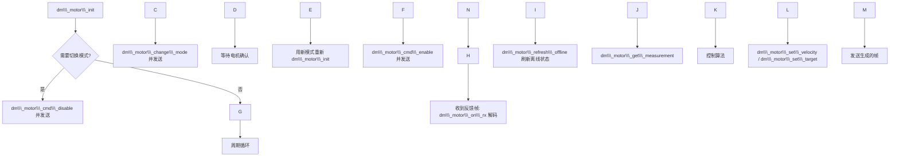

# 达妙 DM-J4310-2EC 电机驱动

基于 STM32 HAL FDCAN 的达妙 DM-J4310-2EC 驱动。模块只负责协议编解码和状态维护，不直接访问 FDCAN 外设：所有发送类接口都只生成 `dm\\\_frame\\\_t`，由调用方发送。

* 通信：标准帧，11 位 ID，固定 8 字节数据
* 模式：MIT、位置速度、速度
* 单位：位置 rad，速度 rad/s，转矩 N·m，温度 ℃
* 语言标准：C11，使用了 `\\\_Static\\\_assert` 和指定初始化器

## 协议速查

### 控制帧

控制帧 ID = 基址 + `device\\\_id`，数据布局由当前模式决定。

|模式|ID 基址|数据|
|-|-|-|
|MIT|`0x000`|8 字节位打包：p\_des 16 位 + v\_des 12 位 + Kp 12 位 + Kd 12 位 + t\_ff 12 位|
|位置速度|`0x100`|p\_des 四字节浮点小端 + v\_des 四字节浮点小端|
|速度|`0x200`|v\_des 四字节浮点小端 + 4 字节 0|

### 反馈帧

反馈帧 ID = `master\\\_id`，即达妙调试助手里的 Master ID，**默认 0**。固定 8 字节。

|字节|内容|
|-|-|
|D\[0] 高 4 位|ERR 状态码：0 失能，1 使能，8..E 故障，明细见下表|
|D\[0] 低 4 位|电机 ID，驱动解成 `measurement.device\\\_id`，只有低 4 位|
|D\[1..2]|位置 16 位|
|D\[3..4]|速度 12 位|
|D\[4..5]|转矩 12 位，与速度共用 D\[4]|
|D\[6]|MOS 温度|
|D\[7]|线圈温度|

达妙反馈不包含电流，只上报转矩，驱动中的转矩直接取自反馈帧。

D\[0] 高 4 位就是 ERR，驱动把它解成 `measurement.status\\\_code`：0 表示驱动器失能，1 表示使能，8到E 表示故障，可用 `DM\\\_MOTOR\\\_STATUS\\\_IS\\\_FAULT()` 判断，判断是否使能则与 `DM\\\_MOTOR\\\_STATUS\\\_ENABLED` 比较。

D\[0] 低 4 位是电机 ID，手册原文是 "ID 表示控制器的 ID，取 CAN\_ID 的低 8 位"，驱动解成 `measurement.device\\\_id`。用途是**核对帧是不是来自你以为的那台电机**：

```c
if ((measurement.device\\\_id \\\& 0x0FU) != (config.device\\\_id \\\& 0x0FU))
{
    /\\\* 反馈来自另一台电机: master\\\_id 可能配重了 \\\*/
}
```

注意两点：

* 只有 4 位，`device\\\_id` 超过 15 会被截断，比如 17 和 1 的低 4 位都是 1，所以它只能用来发现明显配错，不能当作唯一身份；
* 驱动不因为它不匹配就丢弃帧——真正的过滤仍然靠 CAN 仲裁 ID，也就是 `master\\\_id`。

|状态码|宏|含义|
|-|-|-|
|`0x0`|`DM\\\_MOTOR\\\_STATUS\\\_DISABLED`|失能|
|`0x1`|`DM\\\_MOTOR\\\_STATUS\\\_ENABLED`|使能|
|`0x8`|`DM\\\_MOTOR\\\_STATUS\\\_CODE\\\_OVER\\\_VOLTAGE`|超压|
|`0x9`|`DM\\\_MOTOR\\\_STATUS\\\_CODE\\\_UNDER\\\_VOLTAGE`|欠压|
|`0xA`|`DM\\\_MOTOR\\\_STATUS\\\_CODE\\\_OVER\\\_CURRENT`|过电流|
|`0xB`|`DM\\\_MOTOR\\\_STATUS\\\_CODE\\\_MOS\\\_OVER\\\_TEMP`|MOS 过温|
|`0xC`|`DM\\\_MOTOR\\\_STATUS\\\_CODE\\\_COIL\\\_OVER\\\_TEMP`|电机线圈过温|
|`0xD`|`DM\\\_MOTOR\\\_STATUS\\\_CODE\\\_COMM\\\_LOST`|通讯丢失|
|`0xE`|`DM\\\_MOTOR\\\_STATUS\\\_CODE\\\_OVERLOAD`|过载|

驱动不额外维护错误位：具体是哪一种故障，直接看 `measurement.status\\\_code` 的原值；`motor.offline` 给出是否收不到反馈。

### 模式切换帧

ID 固定 `0x7FF`，数据：

```
\\\[device\\\_id, 0x00, 0x55, 0x0A, mode, 0x00, 0x00, 0x00]
```

`mode` 取 `DM\\\_MOTOR\\\_MODE\\\_MIT` / `DM\\\_MOTOR\\\_MODE\\\_POSITION\\\_VELOCITY` / `DM\\\_MOTOR\\\_MODE\\\_VELOCITY`。

### 特殊命令帧

ID 等于当前模式的控制帧 ID；数据为 7 字节 `0xFF` 加 1 字节命令码：

|操作|命令码|接口|
|-|-|-|
|清除故障|`0xFB`|`dm\\\_motor\\\_cmd\\\_clear\\\_error`|
|使能|`0xFC`|`dm\\\_motor\\\_cmd\\\_enable`|
|失能|`0xFD`|`dm\\\_motor\\\_cmd\\\_disable`|
|保存零点|`0xFE`|`dm\\\_motor\\\_cmd\\\_save\\\_zero`|

### 减速比与量程

DM-J4310-2EC 的 10:1 减速比做在电机内部，驱动器发到总线上的已经是减速后的量：

* 反馈帧的 POS / VEL / T 都是**输出轴**量；
* MIT 模式的 `p\\\_des`、`v\\\_des`、`t\\\_ff` 也是**输出轴**量。

判断依据：手册给出的额定扭矩 3 N·m、峰值 7 N·m，额定转速 120 rpm、空载最大 200 rpm；而 MIT 量程是 P\_MAX 12.5 rad、V\_MAX 30 rad/s、T\_MAX 10 N·m，正好是输出轴量级。若这些量是转子侧，转矩和速度都会差 10 倍。

由此可知：

* 驱动的 `gear\\\_ratio` 是**应用侧附加传动比**，比如再串一级皮带传动；达妙内置的 10:1 已经包含在协议里，通常填 `1.0`；
* 位置、速度、转矩在控制帧和反馈帧上是同一个轴，驱动不再做任何 10:1 折算；
* MIT 的 P\_MAX / V\_MAX / T\_MAX 必须在达妙调试助手里设成和驱动常量一致：12.5 rad、30 rad/s、10 N·m，否则编码量程和电机内部对不上；
* Kp 范围 \[0, 500]、Kd 范围 \[0, 5]，与手册一致。

## 控制流程



### 1\. 初始化

`dm\\\_motor\\\_init` 只建立软件实例：复制配置、按模式与电机 ID 算出控制帧 ID、清空状态标志。反馈帧 ID 直接用配置里的 `master\\\_id`，不再另存。它不会向总线发送任何帧。

### 2\. 模式切换与使能

如果电机当前模式与配置不一致，需要先切换模式。注意 `dm\\\_motor\\\_change\\\_mode` 只生成 0x7FF 帧，实际切换在发送后生效；而且切换后控制帧 ID 会变化，驱动实例必须用新模式重新初始化：

```c
dm\\\_frame\\\_t frame;

/\\\* 1. 按旧模式的控制帧 ID 失能 \\\*/
if (DM\\\_OK == dm\\\_motor\\\_cmd\\\_disable(\\\&g\\\_dm\\\_motor, \\\&frame))
{
    g\\\_tx\\\_header.Identifier = frame.id;
    (void)HAL\\\_FDCAN\\\_AddMessageToTxFifoQ(\\\&hfdcan1, \\\&g\\\_tx\\\_header, frame.data);
}

/\\\* 2. 发送模式切换帧 \\\*/
if (DM\\\_OK == dm\\\_motor\\\_change\\\_mode(config.device\\\_id, DM\\\_MOTOR\\\_MODE\\\_MIT, \\\&frame))
{
    g\\\_tx\\\_header.Identifier = frame.id;
    (void)HAL\\\_FDCAN\\\_AddMessageToTxFifoQ(\\\&hfdcan1, \\\&g\\\_tx\\\_header, frame.data);
}

/\\\* 3. 等待电机确认 \\\*/
HAL\\\_Delay(100U);

/\\\* 4. 用新模式重建实例, 控制帧 ID 随之更新 \\\*/
config.mode = DM\\\_MOTOR\\\_MODE\\\_MIT;
(void)dm\\\_motor\\\_init(\\\&g\\\_dm\\\_motor, \\\&config);

/\\\* 5. 使能 \\\*/
if (DM\\\_OK == dm\\\_motor\\\_cmd\\\_enable(\\\&g\\\_dm\\\_motor, \\\&frame))
{
    g\\\_tx\\\_header.Identifier = frame.id;
    (void)HAL\\\_FDCAN\\\_AddMessageToTxFifoQ(\\\&hfdcan1, \\\&g\\\_tx\\\_header, frame.data);
}
```

### 3\. 周期控制

拆成两件事：**收到帧时**解码，**每个控制周期**判离线、取数、下发。

接收侧，通常在中断或接收任务里：

1. 收到反馈帧时调用 `dm\\\_motor\\\_on\\\_rx`，驱动当场解码并刷新 `measurement`，同时清 `offline`；

控制周期，通常在任务里：

2. 调用 `dm\\\_motor\\\_refresh\\\_offline`，判断是否超过 `offline\\\_ms` 没收到帧；
3. 调用 `dm\\\_motor\\\_get\\\_measurement` 取输出轴角度、角速度、转矩、温度和驱动器状态码；
4. 控制算法计算目标；
5. 调用 `dm\\\_motor\\\_set\\\_velocity` 或 `dm\\\_motor\\\_set\\\_target` 直接得到控制帧；
6. 发送。

### 4\. 状态与故障

驱动器自己的故障由反馈帧的 ERR 状态码给出：

|信息|来源|说明|
|-|-|-|
|`measurement.status\\\_code`|反馈帧 D\[0] 高 4 位|0 失能、1 使能、8..E 故障，含义见反馈帧小节|
|`motor.offline`|驱动自行判断|超过 `offline\\\_ms` 没收到反馈即为离线，收到新反馈即恢复|

过温阈值由应用自己按 `measurement.temperature\\\_c` / `measurement.temperature\\\_mos\\\_c` 判断，驱动不做阈值策略。

## 公开 API

### 初始化

|函数|说明|
|-|-|
|`dm\\\_motor\\\_init`|绑定配置并初始化实例，不发送帧|

### 控制目标

|函数|说明|
|-|-|
|`dm\\\_motor\\\_set\\\_velocity`|速度模式专用，设置目标速度并生成控制帧|
|`dm\\\_motor\\\_set\\\_target`|通用接口，按 `target->kind` 选择 MIT / 位置速度 / 速度分支并生成控制帧|

两个函数都直接输出 `dm\\\_frame\\\_t`。`target->kind` 必须与实例当前 `mode` 一致，否则返回 `DM\\\_ERROR`；只有构帧成功才会保存目标，失败时实例里的目标保持不变。

### 模式与特殊命令

|函数|说明|
|-|-|
|`dm\\\_motor\\\_change\\\_mode`|生成 0x7FF 模式切换帧|
|`dm\\\_motor\\\_cmd\\\_enable`|生成使能帧|
|`dm\\\_motor\\\_cmd\\\_disable`|生成失能帧，推荐用它真正切断输出|
|`dm\\\_motor\\\_cmd\\\_clear\\\_error`|生成清除故障帧|
|`dm\\\_motor\\\_cmd\\\_save\\\_zero`|生成保存零点帧，发送时电机应静止|

### 接收与状态

|函数|说明|上下文|
|-|-|-|
|`dm\\\_motor\\\_on\\\_rx`|按 `master\\\_id` 和长度过滤，解码反馈帧并刷新机构系测量值|由调用方保证不并发|
|`dm\\\_motor\\\_refresh\\\_offline`|刷新离线状态|任务上下文|
|`dm\\\_motor\\\_get\\\_measurement`|读取最近一次换算结果|任务上下文|

## 完整示例

下面是一份可直接放进工程的完整流程。示例只有两个应用层入口：初始化和周期控制。

```c
/\\\*\\\*
  \\\* @file    dm\\\_motor\\\_example.c
  \\\* @brief   达妙 DM-J4310-2EC 电机控制完整示例.
  \\\*
  \\\* 依赖:
  \\\*   - dm\\\_motor.h          本驱动
  \\\*   - fdcan.h / main.h    STM32 HAL 与 CubeMX 生成的 hfdcan1
  \\\*
  \\\* 全部流程只调用 HAL 与 dm\\\_motor\\\_\\\* 接口.
  \\\*/

#include "dm\\\_motor.h"

#include "fdcan.h"
#include "main.h"

#include <stdbool.h>
#include <stdint.h>

/\\\*\\\* @brief 电机实例, 由调用方持有. \\\*/
static dm\\\_motor\\\_t g\\\_dm\\\_motor;

/\\\*\\\* @brief 电机 CAN ID, 必须与电机实际配置一致. \\\*/
#define DM\\\_EXAMPLE\\\_DEVICE\\\_ID 1U

/\\\*\\\* @brief 反馈帧 Master ID, 必须与达妙调试助手里设置的一致.
 \\\*  默认是 0; 同一总线挂多台电机时, 每台的 Master ID 必须各不相同. \\\*/
#define DM\\\_EXAMPLE\\\_MASTER\\\_ID 0U

/\\\*\\\* @brief FDCAN 发送帧头, 固定字段在初始化里填一次, Identifier 每帧覆盖. \\\*/
static FDCAN\\\_TxHeaderTypeDef g\\\_tx\\\_header;

/\\\*\\\*
  \\\* @brief  初始化电机: 建立实例, 切模式, 使能.
  \\\* @retval HAL\\\_OK 全部成功.
  \\\*/
HAL\\\_StatusTypeDef app\\\_dm\\\_motor\\\_init(void)
{
    dm\\\_motor\\\_config\\\_t config = {
        .device\\\_id            = DM\\\_EXAMPLE\\\_DEVICE\\\_ID,
        .master\\\_id            = DM\\\_EXAMPLE\\\_MASTER\\\_ID,
        .mode                 = DM\\\_MOTOR\\\_MODE\\\_VELOCITY,
        .gear\\\_ratio           = 1.0f,
        .offline\\\_ms           = 100U,
        .velocity\\\_limit\\\_radps = 30.0f,
        .invert\\\_direction     = false,
    };
    dm\\\_frame\\\_t frame;

    g\\\_tx\\\_header.IdType              = FDCAN\\\_STANDARD\\\_ID;
    g\\\_tx\\\_header.TxFrameType         = FDCAN\\\_DATA\\\_FRAME;
    g\\\_tx\\\_header.DataLength          = FDCAN\\\_DLC\\\_BYTES\\\_8;
    g\\\_tx\\\_header.BitRateSwitch       = FDCAN\\\_BRS\\\_OFF;
    g\\\_tx\\\_header.FDFormat            = FDCAN\\\_CLASSIC\\\_CAN;
    g\\\_tx\\\_header.ErrorStateIndicator = FDCAN\\\_ESI\\\_ACTIVE;
    g\\\_tx\\\_header.TxEventFifoControl  = FDCAN\\\_NO\\\_TX\\\_EVENTS;

    /\\\* 0. 启动 FDCAN. \\\*/
    (void)HAL\\\_FDCAN\\\_ConfigGlobalFilter(\\\&hfdcan1, FDCAN\\\_ACCEPT\\\_IN\\\_RX\\\_FIFO0, FDCAN\\\_ACCEPT\\\_IN\\\_RX\\\_FIFO0,
                                       FDCAN\\\_FILTER\\\_REMOTE, FDCAN\\\_FILTER\\\_REMOTE);
    (void)HAL\\\_FDCAN\\\_Start(\\\&hfdcan1);
    (void)HAL\\\_FDCAN\\\_ActivateNotification(\\\&hfdcan1, FDCAN\\\_IT\\\_RX\\\_FIFO0\\\_NEW\\\_MESSAGE, 0U);
    HAL\\\_NVIC\\\_SetPriority(FDCAN1\\\_IT0\\\_IRQn, 5U, 0U);
    HAL\\\_NVIC\\\_EnableIRQ(FDCAN1\\\_IT0\\\_IRQn);

    /\\\* 1. 建立电机实例, 不发送任何帧. \\\*/
    if (DM\\\_OK != dm\\\_motor\\\_init(\\\&g\\\_dm\\\_motor, \\\&config))
    {
        return HAL\\\_ERROR;
    }

    /\\\* 2. 失能: 切模式前必须先失能. \\\*/
    if (DM\\\_OK != dm\\\_motor\\\_cmd\\\_disable(\\\&g\\\_dm\\\_motor, \\\&frame))
    {
        return HAL\\\_ERROR;
    }

    g\\\_tx\\\_header.Identifier = frame.id;
    (void)HAL\\\_FDCAN\\\_AddMessageToTxFifoQ(\\\&hfdcan1, \\\&g\\\_tx\\\_header, frame.data);

    /\\\* 3. 发送模式切换帧. \\\*/
    if (DM\\\_OK != dm\\\_motor\\\_change\\\_mode(config.device\\\_id, DM\\\_MOTOR\\\_MODE\\\_VELOCITY, \\\&frame))
    {
        return HAL\\\_ERROR;
    }

    g\\\_tx\\\_header.Identifier = frame.id;
    (void)HAL\\\_FDCAN\\\_AddMessageToTxFifoQ(\\\&hfdcan1, \\\&g\\\_tx\\\_header, frame.data);
    HAL\\\_Delay(100U); /\\\* 等待电机确认 \\\*/

    /\\\* 4. 用新模式重建实例: 控制帧 ID 由模式决定, 必须重新 init 才会更新.
     \\\*    init 会清零整个实例, 这一步不要和接收中断并发. \\\*/
    if (DM\\\_OK != dm\\\_motor\\\_init(\\\&g\\\_dm\\\_motor, \\\&config))
    {
        return HAL\\\_ERROR;
    }

    /\\\* 5. 使能 \\\*/
    if (DM\\\_OK != dm\\\_motor\\\_cmd\\\_enable(\\\&g\\\_dm\\\_motor, \\\&frame))
    {
        return HAL\\\_ERROR;
    }

    g\\\_tx\\\_header.Identifier = frame.id;
    (void)HAL\\\_FDCAN\\\_AddMessageToTxFifoQ(\\\&hfdcan1, \\\&g\\\_tx\\\_header, frame.data);

    return HAL\\\_OK;
}

/\\\*\\\*
  \\\* @brief  接收反馈帧, 中断上下文.
  \\\*/
void HAL\\\_FDCAN\\\_RxFifo0Callback(FDCAN\\\_HandleTypeDef \\\*hfdcan, uint32\\\_t RxFifo0ITs)
{
    FDCAN\\\_RxHeaderTypeDef header;
    uint8\\\_t data\\\[DM\\\_MOTOR\\\_FRAME\\\_LEN];

    if ((RxFifo0ITs \\\& FDCAN\\\_IT\\\_RX\\\_FIFO0\\\_NEW\\\_MESSAGE) == 0U)
    {
        return;
    }

    if (HAL\\\_FDCAN\\\_GetRxMessage(hfdcan, FDCAN\\\_RX\\\_FIFO0, \\\&header, data) != HAL\\\_OK)
    {
        return;
    }

    if (header.IdType != FDCAN\\\_STANDARD\\\_ID)
    {
        return;
    }

    dm\\\_motor\\\_on\\\_rx(\\\&g\\\_dm\\\_motor, header.Identifier, data, (uint8\\\_t)header.DataLength, HAL\\\_GetTick());
}

/\\\*\\\*
  \\\* @brief  周期控制: 刷新状态, 判断故障, 下发目标.
  \\\*/
void app\\\_dm\\\_motor\\\_loop(uint32\\\_t now\\\_ms)
{
    dm\\\_motor\\\_measurement\\\_t measurement;
    dm\\\_frame\\\_t frame;
    float target\\\_radps;

    /\\\* 1. 判离线并取一次快照. \\\*/
    (void)dm\\\_motor\\\_refresh\\\_offline(\\\&g\\\_dm\\\_motor, now\\\_ms);
    (void)dm\\\_motor\\\_get\\\_measurement(\\\&g\\\_dm\\\_motor, \\\&measurement);

    /\\\* 2. 故障判断: 离线由驱动给出, 驱动器故障看状态码.
     \\\* status\\\_code 见手册: 8 超压 9 欠压 A 过流 B MOS 过温 C 线圈过温
     \\\* D 通讯丢失 E 过载. 清故障后需要重新使能. \\\*/
    if (g\\\_dm\\\_motor.offline || DM\\\_MOTOR\\\_STATUS\\\_IS\\\_FAULT(measurement.status\\\_code))
    {
        if (DM\\\_OK == dm\\\_motor\\\_cmd\\\_disable(\\\&g\\\_dm\\\_motor, \\\&frame))
        {
            g\\\_tx\\\_header.Identifier = frame.id;
            (void)HAL\\\_FDCAN\\\_AddMessageToTxFifoQ(\\\&hfdcan1, \\\&g\\\_tx\\\_header, frame.data);
        }

        return;
    }

    /\\\* 3. 计算要下发的目标速度 \\\*/
    target\\\_radps = 2.0f;

    /\\\* 4. 下发目标. \\\*/
    if (DM\\\_OK == dm\\\_motor\\\_set\\\_velocity(\\\&g\\\_dm\\\_motor, target\\\_radps, \\\&frame))
    {
        g\\\_tx\\\_header.Identifier = frame.id;
        (void)HAL\\\_FDCAN\\\_AddMessageToTxFifoQ(\\\&hfdcan1, \\\&g\\\_tx\\\_header, frame.data);
    }
}
```

### 多电机

每个电机一个实例，按反馈帧 ID 分发到不同实例。`HAL\\\_FDCAN\\\_Start` 与中断使能同上，只做一次。下面的 `0x11` / `0x12` 是调试助手改过的值，出厂默认都是 0，多台挂一条总线时必须逐台改开：

```c
void HAL\\\_FDCAN\\\_RxFifo0Callback(FDCAN\\\_HandleTypeDef \\\*hfdcan, uint32\\\_t RxFifo0ITs)
{
    FDCAN\\\_RxHeaderTypeDef header;
    uint8\\\_t data\\\[DM\\\_MOTOR\\\_FRAME\\\_LEN];

    if ((RxFifo0ITs \\\& FDCAN\\\_IT\\\_RX\\\_FIFO0\\\_NEW\\\_MESSAGE) == 0U)
    {
        return;
    }

    if (HAL\\\_FDCAN\\\_GetRxMessage(hfdcan, FDCAN\\\_RX\\\_FIFO0, \\\&header, data) != HAL\\\_OK)
    {
        return;
    }

    switch (header.Identifier)
    {
    case 0x11U:
        dm\\\_motor\\\_on\\\_rx(\\\&g\\\_dm\\\_motor\\\_a, header.Identifier, data, (uint8\\\_t)header.DataLength,
                       HAL\\\_GetTick());
        break;

    case 0x12U:
        dm\\\_motor\\\_on\\\_rx(\\\&g\\\_dm\\\_motor\\\_b, header.Identifier, data, (uint8\\\_t)header.DataLength,
                       HAL\\\_GetTick());
        break;

    default:
        break;
    }
}
```

### MIT 模式目标

在周期控制里下发：

```c
dm\\\_motor\\\_cmd\\\_t target = {
    .kind = DM\\\_MOTOR\\\_MODE\\\_MIT,
    .u.mit =
        {
            .position\\\_rad   = 0.0f,
            .velocity\\\_radps = 0.0f,
            .kp             = 20.0f,
            .kd             = 1.0f,
            .torque\\\_n\\\_m     = 0.0f,
        },
};
dm\\\_frame\\\_t frame;

if (DM\\\_OK == dm\\\_motor\\\_set\\\_target(\\\&g\\\_dm\\\_motor, \\\&target, \\\&frame))
{
    g\\\_tx\\\_header.Identifier = frame.id;
    (void)HAL\\\_FDCAN\\\_AddMessageToTxFifoQ(\\\&hfdcan1, \\\&g\\\_tx\\\_header, frame.data);
}
```

### 位置速度模式目标

```c
dm\\\_motor\\\_cmd\\\_t target = {
    .kind = DM\\\_MOTOR\\\_MODE\\\_POSITION\\\_VELOCITY,
    .u.position\\\_velocity =
        {
            .position\\\_rad   = 1.0f,
            .velocity\\\_radps = 2.0f,
        },
};
dm\\\_frame\\\_t frame;

if (DM\\\_OK == dm\\\_motor\\\_set\\\_target(\\\&g\\\_dm\\\_motor, \\\&target, \\\&frame))
{
    g\\\_tx\\\_header.Identifier = frame.id;
    (void)HAL\\\_FDCAN\\\_AddMessageToTxFifoQ(\\\&hfdcan1, \\\&g\\\_tx\\\_header, frame.data);
}
```

### 特殊命令

```c
dm\\\_frame\\\_t frame;

/\\\* 清除驱动器故障, 清完后需要重新使能 \\\*/
if (DM\\\_OK == dm\\\_motor\\\_cmd\\\_clear\\\_error(\\\&g\\\_dm\\\_motor, \\\&frame))
{
    g\\\_tx\\\_header.Identifier = frame.id;
    (void)HAL\\\_FDCAN\\\_AddMessageToTxFifoQ(\\\&hfdcan1, \\\&g\\\_tx\\\_header, frame.data);
}

/\\\* 把当前位置保存为机械零点, 发送时电机必须静止 \\\*/
if (DM\\\_OK == dm\\\_motor\\\_cmd\\\_save\\\_zero(\\\&g\\\_dm\\\_motor, \\\&frame))
{
    g\\\_tx\\\_header.Identifier = frame.id;
    (void)HAL\\\_FDCAN\\\_AddMessageToTxFifoQ(\\\&hfdcan1, \\\&g\\\_tx\\\_header, frame.data);
}
```

## 配置字段

|字段|类型|说明|
|-|-|-|
|`device\\\_id`|`uint8\\\_t`|电机 CAN ID，范围 1 到 127|
|`master\\\_id`|`uint8\\\_t`|反馈帧 ID，范围 0 到 127，**默认 0**；同一总线挂多台时必须各不相同|
|`mode`|`DM\\\_MOTOR\\\_MODE`|控制模式，决定控制帧 ID 和数据布局|
|`gear\\\_ratio`|`float`|应用侧附加传动比，必须大于 0；达妙内置 10:1 已含在协议里，通常填 1.0|
|`offline\\\_ms`|`uint32\\\_t`|离线判定阈值，0 表示关闭|
|`velocity\\\_limit\\\_radps`|`float`|速度限幅，0 表示不额外限幅；作用于速度模式指令和位置速度模式的限速|
|`invert\\\_direction`|`bool`|安装方向取反，指令与反馈统一乘符号|

## 注意事项

1. **协议两侧都是输出轴量**：达妙内置的 10:1 减速比已经体现在反馈帧和 MIT 控制帧里，指令不参与换算。`gear\\\_ratio` 只用于应用侧额外传动，填 1.0 即可；它只作用于反馈换算，角度和角速度除以它，转矩乘以它。
2. **目标模式必须匹配**：`dm\\\_motor\\\_set\\\_target` 的 `target->kind` 必须等于实例当前 `mode`，否则返回 `DM\\\_ERROR`。
3. **量程饱和**：位置 ±12.5 rad、速度 ±30 rad/s、转矩 ±10 N·m、Kp 0 到 500、Kd 0 到 5，超出范围由编码函数饱和。
4. **驱动不做并发保护**：所有接口都假定调用方已经保证串行访问同一个实例。`dm\\\_motor\\\_on\\\_rx` 会直接改写 `measurement`，若它与 `dm\\\_motor\\\_refresh\\\_offline`、`dm\\\_motor\\\_get\\\_measurement` 并发执行，可能读到写了一半的测量值。后果由调用方负责。
5. **想避免并发，最简单的做法是让接收和解码在同一个上下文**：例如 BSP 里用一个接收任务轮询 CAN FIFO，取到帧就调 `dm\\\_motor\\\_on\\\_rx`，控制任务从这份测量值读数；或者在中断里只做搬运，把帧交给任务后再调 `dm\\\_motor\\\_on\\\_rx`。两种方式下驱动内部都不需要额外同步。
6. **运行时切模式必须重新初始化**，否则后续使能帧会发到旧模式的控制帧 ID。
7. **故障判断在应用层**：驱动只提供 `measurement.status\\\_code` 表示驱动器故障与过温，`motor.offline` 表示是否收不到反馈。
8. **反馈长度**：HAL 的 `RxHeaderTypeDef.DataLength` 是 DLC 编码值，8 字节时为 8，可以直接传给 `dm\\\_motor\\\_on\\\_rx`；若接 FD 长帧需要先换算成实际字节数。
9. **一个实例只能由一个消费者持有**，不要在多个任务里同时操作同一个 `dm\\\_motor\\\_t`。
10. **重新初始化与接收并发**：`dm\\\_motor\\\_init` 会清零整个实例。如果在 `dm\\\_motor\\\_on\\\_rx` 正在写测量值时调用，比如运行时切模式后重建实例，可能把写了一半的测量值当成有效反馈。切模式重建实例前建议先失能，并短暂停止该实例的接收。

### 并发由调用方保证

驱动内部不做任何同步，实例里的每个字段都是"当前状态"，由调用方自己保证访问顺序。常见的三种组织方式：

* **接收和解码在同一个任务**：BSP 里用一个任务轮询 CAN FIFO，取到帧就调 `dm\\\_motor\\\_on\\\_rx`，控制循环从同一份 `measurement` 读数。全程单线程，没有并发问题，控制周期也不会被中断打断；
* **中断里只搬运，任务里解码**：中断把帧塞进自己的环形缓冲，任务取出来后再调 `dm\\\_motor\\\_on\\\_rx`；
* **中断里直接解码**：`dm\\\_motor\\\_on\\\_rx` 里有浮点运算，Cortex-M7 带 FPU，代价是几十个周期，可以放在中断里，但读取 `measurement` 的地方必须与它串行——最简单的做法是读取也放在中断里，或者用关中断的临界区把整段读包起来。

无论哪种方式，都不要让 `dm\\\_motor\\\_on\\\_rx` 与读取测量值的代码并发执行。

