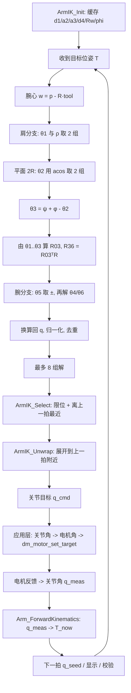

# 机械臂运动学：矩阵运算 / 正解 / 逆解

`arm_math`、`arm_kinematics`、`arm_ik` 三个模块合起来提供这套六轴机械臂的位姿计算。分工是单向的：矩阵运算只管 4×4 齐次矩阵，正解用矩阵连乘，逆解是纯解析式、不做 4×4 矩阵运算。

- 机器人构型：6R 球形腕，MDH 参数为 `alpha = {0, +90°, 0, +90°, −90°, +90°}`，`a0 = a1 = a4 = a5 = 0`，`d2 = d3 = d5 = 0`
- 单位：长度 m，角度 rad；接口内部不做角度制转换
- 数值类型：`float`，三角与反三角全部用 `sinf` / `cosf` / `atan2f` / `acosf`
- 语言标准：C99 及以上；只依赖 `<math.h>`，无动态内存，无内部状态（模型由调用方持有）
- 逆解模块不访问 FDCAN、不持有电机实例，只输出关节角，由应用层转成电机目标

三个文件的关系：

```
arm_math.c        4x4 矩阵乘 / 单位阵
      ↑
arm_kinematics.c  正解：q -> T（只用矩阵）
      ↑
arm_ik.c          逆解：T -> 最多 8 组 q（解析式，不用矩阵）
```

编译时的依赖关系：

| 文件 | 需要包含 | 说明 |
| ---- | -------- | ---- |
| `Src/arm_math.c` | `arm_math.h` | 无外部依赖 |
| `Src/arm_kinematics.c` | `arm_kinematics.h`（内含 `arm_math.h`、`<math.h>`） | 定义 `arm_params[6]` |
| `Src/arm_ik.c` | `arm_ik.h`（内含 `arm_kinematics.h`） | 逆解，需与上面两个文件一起链接 |

> `arm_ik.c / arm_ik.h` 目前放在工作区的 `ik_solution/` 下，接入工程时拷到 `RoboticArm/Src`、`RoboticArm/Inc` 即可，下文按拷贝后的路径叙述。

## 约定速查

### 矩阵与 DH

单节变换用改进 DH（Craig）约定：

```
A_i = Rx(alpha_i-1) · Tx(a_i-1) · Rz(theta_i) · Tz(d_i)
theta_i = offset_i + dir_i * q_i        (dir_i = ±1)
T_0_6 = A_1 · A_2 · A_3 · A_4 · A_5 · A_6
```

展开成 4×4：

```
[ ct    -st     0     a    ]
[ st·ca  ct·ca -sa   -d·sa ]
[ st·sa  ct·sa  ca    d·ca ]
[ 0      0      0     1    ]
```

其中 `ct = cos(theta)`、`ca = cos(alpha)`。

### 参数表

`arm_params[6]` 定义在 `arm_kinematics.c`，字段顺序与 `MHD_Param_t` 一致：

| i | alpha (rad) | a (m)  | d (m)  | offset (rad) | dir |
| - | ----------- | ------ | ------ | ------------ | --- |
| 1 | 0           | 0      | 0.07   | 0            | +1  |
| 2 | +π/2        | 0      | 0      | 0            | +1  |
| 3 | 0           | −0.3583| 0      | +π/2         | +1  |
| 4 | +π/2        | 0.07   | 0.3583 | 0            | +1  |
| 5 | −π/2        | 0      | 0      | 0            | +1  |
| 6 | +π/2        | 0      | 0      | 0            | +1  |

`arm_ik` 从这张表里取出四个几何量并缓存：

| 名称 | 来源 | 本机数值 | 含义 |
| ---- | ---- | -------- | ---- |
| `d1` | `dh[0].d` | 0.07 | 基座高度，关节 1 与关节 2 的交点高度 |
| `a2` | `dh[2].a` | −0.3583 | 大臂长（带符号） |
| `a3` | `dh[3].a` | 0.07 | 小臂横向偏置 |
| `d4` | `dh[3].d` | 0.3583 | 腕心沿关节 4 轴的偏置 |
| `Rw` | `hypotf(a3, d4)` | 0.365074 | 等效小臂长 |
| `phi` | `atan2f(d4, a3)` | 1.377860 (78.95°) | 小臂相位角 |

### 位姿矩阵

`Matrix4x4.data[4][4]` 为行主序齐次矩阵，左上 3×3 是旋转，第 4 列是平移：

```
T = [ R  p ]      p = (x, y, z)，即末端（本机为腕心/法兰）原点
    [ 0  1 ]
```

因为 `a4 = a5 = 0`、`d5 = d6 = 0`，关节 4/5/6 交于一点，法兰原点就是腕心，正解输出的 `x, y, z` 直接就是腕心坐标。

### 零位校验

`q = 0` 时的正解应为：

```
T(0) = [ 0   0   1   0    ]
       [ 0  -1   0   0    ]
       [ 1   0   0   0.14 ]
       [ 0   0   0   1    ]
```

即腕心在 (0, 0, 0.14)，工具 z 轴指向基座 +x。对不上就说明 DH 约定或 `offset` 用错了，不要继续往下查。

## 计算流程



### 1. 初始化

`ArmIK_Init` 复制一份 DH 表，检查几何前提，再缓存 `d1/a2/a3/d4/Rw/phi`。它不分配内存、不发送任何帧。

检查项：

- `alpha` 必须是 `{0, +π/2, 0, +π/2, −π/2, +π/2}`（容差 1e-4 rad）；
- `a0 = a1 = a4 = a5 = 0`、`d2 = d3 = d5 = 0`，否则球形腕或「θ1 只绕 z 转」不成立；
- `dir` 必须是 ±1，否则 `q` 与 `theta` 不是一一对应；
- `a2` 与 `Rw` 不能为 0。

任何一项不满足就返回 `ARM_IK_BAD_MODEL`，模型不可用。这一步的作用是防止改了 DH 却忘了改逆解、最后拿到一组"看起来像解"的错误角度。

默认工具点为 `(0, 0, d6)`；法兰上装了夹爪就用 `ArmIK_SetTool` 覆盖成 TCP 相对法兰的平移。

### 2. 正解

`Arm_ForwardKinematics` 按 `T = A1·A2·…·A6` 依次右乘，最后同时给出 `x, y, z` 和完整矩阵。

注意两点：

- 矩阵乘法的结果写回第一个操作数（`Matrix_Multiply4x4(&T_current, &T_step, &T_current)`），所以 `Matrix_Multiply4x4` **必须允许 `C` 与 `A` 是同一个矩阵**：先算到临时矩阵，最后一次性写回。边算边写会把后面还要用的 `A[i][k]` 覆盖掉，结果是"不报错但全错"。
- `M_PI` 不是 C99 标准宏，armclang 默认不定义它。`arm_kinematics.c` 里要自带：

```c
#ifndef M_PI
#define M_PI 3.14159265358979f
#endif
```

**欧拉角。** `Arm_MatrixToEulerZYX` 从 `T` 左上 3×3 取出姿态，约定为 ZYX 顺序：

```
R = Rz(yaw) · Ry(pitch) · Rx(roll)     ← 与 ROS/URDF 的 rpy 相同（固定轴 x→y→z）

pitch = atan2f(-R[2][0], sqrtf(R[0][0]² + R[1][0]²))
yaw   = atan2f( R[1][0],  R[0][0])
roll  = atan2f( R[2][1],  R[2][2])
```

`roll/pitch/yaw` 分别是绕基座 x/y/z 轴的转角，单位 rad，范围 `(-π, π]`（`pitch` 为 `[-π/2, π/2]`）。`cos(pitch) < 1e-6` 时进入万向锁，此时只有 `roll ± yaw`（或 `roll − yaw`）确定，约定 `roll = 0`、`yaw = atan2f(-R[0][1], R[1][1])`。

注意 `q = 0` 的姿态是 `pitch = -90°`，正好落在万向锁边界上，所以零位下看不到 `roll/yaw` 的正常值（会得到 `roll = 0`、`yaw = ±180°`）；测试欧拉角不要用零位。

### 3. 逆解

先求腕心 `w = p − R·tool`，再把位置和姿态分开解。

**位置（θ1–θ3）。** 把 A1…A4 的平移展开：

```
ρ    = a2·cosθ2 + a3·cos(θ2+θ3) + d4·sin(θ2+θ3)
w_z  = d1 + a2·sinθ2 + a3·sin(θ2+θ3) − d4·cos(θ2+θ3)
```

令 `Rw = hypot(a3, d4)`、`φ = atan2(d4, a3)`、`ψ = θ2+θ3−φ`，就化成平面 2R：

```
ρ       = a2·cosθ2 + Rw·cosψ
w_z−d1  = a2·sinθ2 + Rw·sinψ
```

消去 ψ 得到 θ2 的余弦方程：

```
X = ρ,  Y = w_z − d1
X·cosθ2 + Y·sinθ2 = (X² + Y² + a2² − Rw²) / (2·a2) ≡ k
θ2 = atan2f(Y, X) ± acosf(k / hypotf(X, Y))      ← 肘 2 解
ψ  = atan2f(Y − a2·sinθ2, X − a2·cosθ2)
θ3 = ψ + φ − θ2
```

θ1 有 2 解：`atan2f(w_y, w_x)` 配 `ρ = +r`，或 `+π` 配 `ρ = −r`，`r = hypotf(w_x, w_y)`。这就是"正伸/反伸"两个肩分支。

**姿态（θ4–θ6）。** 先由 θ1–θ3 求 `R03`，再用 `R36 = R03ᵀ·R`：

```
R03 = [ c23·c1, -c1·s23,  s1 ]
      [ s1·c23, -s1·s23, -c1 ]
      [ s23,     c23,     0  ]
```

`R36` 与三个腕角的固定关系是 `R36 = Rx(π/2)·Rz(θ4)·Rx(−π/2)·Rz(θ5)·Rx(π/2)·Rz(θ6)`，展开后只用到四个元素：

```
θ5 = ±acosf(−R36[1][2])                            ← 腕 2 解
θ4 = atan2f(R36[2][2]/sinθ5, R36[0][2]/sinθ5)
θ6 = atan2f(−R36[1][1]/sinθ5, R36[1][0]/sinθ5)
```

腕奇异（`sinθ5 ≈ 0`）时 θ4、θ6 只剩和或差，按 `q_seed` 分配 θ4：

```
θ5 = 0 :  θ4 + θ6 = atan2f( R36[2][0],  R36[0][0])
θ5 = π :  θ4 − θ6 = atan2f(−R36[2][0], −R36[0][0])
```

**总共 8 组**：肩 2 × 肘 2 × 腕 2。求完把 `theta` 按 `q = dir·(theta − offset)` 换回关节角，归一到 (−π, π]，再去重（奇异时多个分支会重合）。

### 4. 奇异与不可达

`ArmIK_Solution.status` 直接给出这一组解的质量：

| 状态 | 值 | 触发条件 | 处理建议 |
| ---- | -- | -------- | -------- |
| `ARM_IK_OK` | 0 | 正常 | 直接用 |
| `ARM_IK_UNREACHABLE` | 1 | `k/hypot(X,Y)` 超出 [−1, 1]，或 `R36[1][2]` 超出 [−1, 1] | 返回的是**夹到边界后的最小二乘解**，不是真解；应用层应保持上一拍目标或减速停 |
| `ARM_IK_WRIST_SINGULAR` | 2 | `sinθ5 ≈ 0`（q5 = 0 或 π） | 只有 θ4+θ6 或 θ4−θ6 确定；按 `q_seed` 的 θ4 分配，q4/q6 要限速 |
| `ARM_IK_SHOULDER_SINGULAR` | 3 | 腕心落在关节 1 轴线上（r ≈ 0） | θ1 任意；用 `q_seed[0]` 填充，只保留一支 |

不可达时**不会**返回 NaN 或空数组，而是给出连续的最小二乘解。这是有意的：轨迹稍微出界时关节角不会跳变，但调用方必须查 `status`，不能把 `ARM_IK_UNREACHABLE` 当成正常解下发。

### 5. 选解与连续性

`ArmIK_Solve` 只负责"算全"，不负责"选对"。选解在应用层，两个工具函数：

- `ArmIK_Select`：按关节空间加权 L1 距离 `Σ w_i·|q_i − q_pref_i|` 排序，先剔除超限位的，`ARM_IK_UNREACHABLE` 额外加罚（`+1e6`），返回最优下标；无合法解返回 −1。
- `ArmIK_Unwrap`：把解展开到 `q_pref ± π` 范围内，避免同一构型出现 ±2π 跳变。

`q_seed` 有两个作用：腕奇异时决定 θ4 的分配，肩奇异时决定 θ1。**传上一拍的实际关节角**，不要传上一拍的指令角，否则伺服没跟上时会产生分支漂移。

### 6. 回代校验

`ArmIK_Residual(T, q)` 调 `Arm_ForwardKinematics` 把解代回去，返回 4×4 元素的最大绝对误差。

- `float` 下正常解在 1e-6 量级，`< 1e-4` 可以认为正确；
- 明显偏大时，按"电机零点 → 安装方向 → DH 参数"的顺序查，而不是先怀疑求解器；
- 它用的是全局 `arm_params`，所以 `ArmIK_Model` 必须是用同一张表初始化出来的。

## 公开 API

常量：`ARM_IK_DOF = 6`，`ARM_IK_MAX_SOLUTIONS = 8`。`ArmIK_Solve` 返回实际解数，`out[]` 至少要能放 8 个元素。

### 矩阵

| 函数 | 说明 |
| ---- | ---- |
| `Matrix_Multiply4x4` | `C = A·B`，要求支持 `C` 与 `A`（或 `B`）为同一矩阵 |
| `Matrix_Indentity4x4` | 置为单位阵 |

### 初始化

| 函数 | 说明 |
| ---- | ---- |
| `ArmIK_Init` | 绑定 DH 表、检查几何前提、缓存几何量，不发送任何帧 |
| `ArmIK_SetTool` | 覆盖 TCP 相对法兰的平移，默认 `(0, 0, d6)` |

### 正解 / 逆解

| 函数 | 说明 | 上下文 |
| ---- | ---- | ------ |
| `Arm_ForwardKinematics` | `q → T`，同时输出 `x, y, z` | 任务上下文 |
| `Arm_MatrixToEulerZYX` | `T → roll/pitch/yaw`（ZYX 顺序，万向锁时 `roll = 0`） | 任务上下文 |
| `ArmIK_Solve` | `T → 最多 8 组 q`，带奇异与不可达标记 | 任务上下文 |
| `ArmIK_Residual` | 正解回代，返回最大绝对误差 | 任务上下文 |

### 选解与连续性

| 函数 | 说明 |
| ---- | ---- |
| `ArmIK_Select` | 限位过滤 + 关节空间最近解，返回下标或 −1 |
| `ArmIK_Unwrap` | 把解展开到参考角附近，消除 ±2π 跳变 |

## 完整示例

```c
/**
  * @file    arm_kinematics_example.c
  * @brief   正解 -> 逆解 -> 选解 -> 下发的最小闭环.
  *
  * 依赖:
  *   - arm_math.h / arm_kinematics.h   矩阵与正解
  *   - arm_ik.h                        逆解
  *   - dm_motor.h                      电机层, 只负责生成帧
  */

#include "arm_ik.h"
#include "arm_kinematics.h"
#include "dm_motor.h"

/** @brief 逆解模型, 全局一份. */
static ArmIK_Model g_arm_ik;

/** @brief 电机实例, 定义在电机侧. */
static dm_motor_t g_dm_motor;

/** @brief 上一拍实际关节角, 作为 q_seed. */
static float g_q_last[ARM_IK_DOF];

/** @brief 关节限位, 按机构实际填. */
static const float g_q_min[ARM_IK_DOF] = { -3.0f, -2.6f, -2.6f, -3.0f, -2.0f, -3.0f };
static const float g_q_max[ARM_IK_DOF] = {  3.0f,  2.6f,  2.6f,  3.0f,  2.0f,  3.0f };

/* arm_params 定义在 arm_kinematics.c, 其他文件用 extern 声明 */
extern const MHD_Param_t arm_params[6];

/**
  * @brief  初始化运动学.
  * @retval ARM_IK_OK 成功.
  */
ArmIK_Status app_kinematics_init(void)
{
    return ArmIK_Init(&g_arm_ik, arm_params);
}

/**
  * @brief  给定目标位姿, 选一组关节角.
  * @param  T 目标位姿, 4x4 行主序.
  * @param  q_out 输出关节角, 6 个.
  * @retval 0 成功; -1 无合法解.
  */
int app_kinematics_solve(const float T[4][4], float q_out[ARM_IK_DOF])
{
    ArmIK_Solution sol[ARM_IK_MAX_SOLUTIONS];
    int n;
    int best;

    n = ArmIK_Solve(&g_arm_ik, T, sol, g_q_last);
    if (n <= 0)
    {
        return -1;
    }

    best = ArmIK_Select(sol, n, g_q_last, g_q_min, g_q_max, NULL);
    if (best < 0)
    {
        return -1;
    }

    ArmIK_Unwrap(sol[best].q, g_q_last);

    for (int i = 0; i < ARM_IK_DOF; ++i)
    {
        q_out[i] = sol[best].q[i];
    }

    return 0;
}

/**
  * @brief  周期控制: 反馈 -> 正解 -> (需要时)逆解 -> 电机目标.
  */
void app_kinematics_loop(void)
{
    float T_now[4][4];
    float q_cmd[ARM_IK_DOF];
    dm_motor_cmd_t target;
    dm_frame_t frame;

    /* 1. 取关节反馈, 作为下一拍的 seed 与正解输入 */
    /* q_meas 由各关节 measurement.angle_rad 减去零点得到, 见下一节 */
    /* Arm_ForwardKinematics(q_meas, &x, &y, &z, &T_now); */

    /* 2. 有新目标时求解, 否则沿用上一拍 q_cmd */
    /* app_kinematics_solve(T_target, q_cmd); */

    /* 3. 关节角 -> 电机角, 生成控制帧 */
    target.kind = DM_MOTOR_MODE_MIT;
    target.u.mit.kp = 20.0f;
    target.u.mit.kd = 1.0f;
    /* target.u.mit.position_rad = q_cmd[i] + q_zero[i];
     * 有外部减速箱时再乘 gear_ratio, 直驱时 gear_ratio = 1 */

    (void)dm_motor_set_target(&g_dm_motor, &target, &frame);
    /* 发送 frame: 由应用层填 FDCAN_TxHeaderTypeDef 并调 HAL_FDCAN_AddMessageToTxFifoQ */
}
```

### 一组实际数据

取 `q = [0.3, −0.7, 1.1, 0.2, 0.5, −0.4]`，正解得到：

```
T = [ -0.7774   0.0660   0.6255   0.0274 ]
    [ -0.0091  -0.9955   0.0938   0.0085 ]
    [  0.6290   0.0673   0.7745   0.5048 ]
    [  0        0        0        1      ]
```

把这组 `T` 送回逆解，得到 8 组解（`branch` = 肩/肘/腕）：

| # | 肩 | 肘 | 腕 | q [rad] | 回代误差 |
| - | -- | -- | -- | ------- | -------- |
| 1 | 0 | 0 | 0 | 0.300, −2.573, −1.486,  3.043,  1.333,  2.941 | 4.4e-16 |
| 2 | 0 | 0 | 1 | 0.300, −2.573, −1.486, −0.098, −1.333, −0.201 | 3.3e-16 |
| 3 | 0 | 1 | 0 | **0.300, −0.700, 1.100, 0.200, 0.500, −0.400** | 3.3e-16 |
| 4 | 0 | 1 | 1 | 0.300, −0.700,  1.100, −2.942, −0.500,  2.742 | 3.3e-16 |
| 5 | 1 | 0 | 0 | −2.842, −2.442, −1.486, −2.405, 0.142, −0.956 | 8.3e-16 |
| 6 | 1 | 0 | 1 | −2.842, −2.442, −1.486, 0.737, −0.142, 2.186 | 7.8e-16 |
| 7 | 1 | 1 | 0 | −2.842, −0.568, 1.100, −0.096, 1.717, 2.904 | 3.6e-16 |
| 8 | 1 | 1 | 1 | −2.842, −0.568, 1.100,  3.045, −1.717, −0.238 | 2.2e-16 |

第 3 组正是原始构型。注意第 5–8 组肩分支为 1，q1 从 0.3 变成 −2.842（即 0.3 + π 归一化后），对应"反伸"构型；实际选哪组由 `ArmIK_Select` 按上一拍位置决定。

## 配置字段

### `MHD_Param_t`

| 字段 | 类型 | 说明 |
| ---- | ---- | ---- |
| `alpha` | `float` | 上一节 z 轴到本节 z 轴的扭角，单位 rad |
| `a` | `float` | 上一节 z 轴到本节 z 轴的公垂线长度，单位 m |
| `d` | `float` | 沿本节 z 轴的偏置，单位 m |
| `offset` | `float` | 关节零位偏置，单位 rad |
| `dir` | `float` | 关节方向，只能取 +1 或 −1 |

### `ArmIK_Model`

| 字段 | 类型 | 说明 |
| ---- | ---- | ---- |
| `dh[6]` | `MHD_Param_t` | DH 表副本，`ArmIK_Init` 复制 |
| `d1` / `a2` / `a3` / `d4` | `float` | 逆解用到的四个几何量 |
| `Rw` / `phi` | `float` | 等效小臂长与小臂相位角 |
| `tool[3]` | `float` | 法兰原点 → TCP，默认 `(0, 0, d6)` |
| `valid` | `int` | 1 表示通过几何前提检查 |

### `ArmIK_Solution`

| 字段 | 类型 | 说明 |
| ---- | ---- | ---- |
| `q[6]` | `float` | 关节角，单位 rad，已归一到 (−π, π] |
| `branch` | `uint8_t` | bit0 肩（0 正伸 / 1 反伸），bit1 肘，bit2 腕 |
| `status` | `uint8_t` | `ArmIK_Status`，见"奇异与不可达" |

## 与电机层对接

`arm_ik` 输出的是 **DH 关节角 `q`**；`dm_motor` 收发的是 **电机输出轴角**。两者之间只差一个线性换算，但方向符号只能在一个地方取反。

### 角度换算

```c
/* 反馈: 电机角 -> 关节角 (gear_ratio 已在驱动内部除过, q_zero 也是机构系) */
q_meas[i] = measurement.angle_rad - q_zero[i];

/* 指令: 关节角 -> 电机目标 (直驱 gear_ratio = 1 时就是加零点) */
target.u.mit.position_rad = (q_cmd[i] + q_zero[i]) * gear_ratio;
```

- `measurement.angle_rad` 已经除以 `gear_ratio`、并按 `invert_direction` 取反，是**机构系**角度，范围约 ±12.5 rad，**未归一化**；
- 指令侧 `dm_motor` **不做** `gear_ratio` 换算（见电机驱动说明），所以有外部减速箱时要把机构系目标乘回 `gear_ratio` 再传；本机直驱，`gear_ratio = 1.0f`，乘不乘一样；
- `q_zero[i]` 是机械零位对应的机构系角度。用 `dm_motor_cmd_save_zero` 把当前位存成电机零点后，`q_zero` 通常就是 0；没存零点时，把上电时的 `angle_rad` 记为 `q_zero`；
- `arm_params[i].dir` 全为 +1，安装方向统一交给 `dm_motor` 的 `invert_direction`，**不要两边都取反**。

### 方向核对

让关节朝 DH 定义的正方向转一点，同时看：

1. `measurement.angle_rad` 变大 → 方向对；
2. `Arm_ForwardKinematics` 算出的 `T_now` 与肉眼看到的运动一致 → DH 对；
3. 若 1 反了，改 `invert_direction`；若 2 不对，查 `offset` 或 `alpha`。

### 周期分工

| 频率 | 做什么 |
| ---- | ------ |
| 1 kHz | 读反馈、`Arm_ForwardKinematics`、关节插值、限幅限速、`dm_motor_set_target`、发送 |
| 100–200 Hz 或事件触发 | `ArmIK_Solve` + `ArmIK_Select`，得到新的 `q_cmd` |
| 上电一次 | `ArmIK_Init`、标定 `q_zero`、用当前 `q_meas` 正解出 `T_now` 作为轨迹起点 |

笛卡尔直线运动要在 1 kHz 里插值 `T` 并每拍逆解也可以：单次求解是几十次三角运算加一次 `acos`，量级在几十微秒（未实测，取决于主频与优化等级）；但要注意每拍都要更新 `q_seed`，否则分支会跳。

## 注意事项

1. **矩阵乘法必须支持别名**：正解里 `C` 和 `A` 是同一个矩阵，实现要先算到临时矩阵再写回。边算边写不会报错，但结果完全错误。
2. **`M_PI` 要自己定义**：armclang 在 C99 下不提供 `M_PI`，`arm_kinematics.c` 需要自带 `#define`。
3. **`q = 0` 是肩奇异位形**：腕心正好落在关节 1 轴线上，θ1 任意。不要拿零位当"随便一个位姿"去测逆解精度。
4. **方向符号只取反一次**：`arm_params[].dir` 与 `dm_motor.invert_direction` 二选一，重复取反会得到镜像构型。
5. **`q_seed` 传实测角**：它决定奇异时的 θ4 分配和选解基准，传指令角会在伺服滞后时漂分支。
6. **不可达不是错误**：`ARM_IK_UNREACHABLE` 返回的是夹到边界的最小二乘解，必须查 `status` 再决定是否下发。
7. **腕奇异要限速**：q5 ≈ 0 时 q4/q6 只有和/差确定，单关节可能突跳；歧义由 `q_seed` 消解，但仍应限制 q4/q6 的角速度。
8. **`ArmIK_Residual` 用全局 `arm_params`**：模型必须由同一张表初始化，否则回代校验没有意义。
9. **逆解不做限位**：`ArmIK_Solve` 会返回超限位的解，限位只在 `ArmIK_Select` 里过滤；直接遍历 `sol[]` 下发会撞限位。
10. **`arm_params` 的作用域**：它定义在 `arm_kinematics.c` 且为 `const`，其他文件要么加 `extern` 声明，要么在头文件里补一行声明。
11. **`ArmIK_Init` 会拒绝不合规的 DH**：改了 `alpha` 或把 `a4/a5` 填成非零，会返回 `ARM_IK_BAD_MODEL`，这是有意为之——本闭式解只对球形腕成立。
12. **工具点默认是法兰**：装了夹爪、焊枪等，必须 `ArmIK_SetTool` 填 TCP 相对法兰的平移，否则逆解算的是法兰位姿。
13. **可重入，但不是线程安全**：三个模块都没有内部状态，`ArmIK_Solve` 只读 `model`、只写 `out`；同一个 `ArmIK_Model` 可以被多个任务同时读，但 `out[]`、`q_seed` 要各自持有。正解写 `T_out`，也不要多个任务共用同一块输出。

## 验证

`ik_solution/` 下有三套等价的验证材料：

| 材料 | 内容 | 结果 |
| ---- | ---- | ---- |
| `matlab/arm_test.m` | MATLAB 参考实现，500 组随机位姿闭环 + 3 组奇异位形 | 0 失败，最大残差 4.4e-16 |
| `matlab/arm_model.m` + `arm_test.m` | Robotics Toolbox 交叉验证：`SerialLink.fkine` 对比解析正解 | 200 组，最大偏差 3.9e-16 |
| `work/mirror.py` | 与 `arm_ik.c` 逐行对应的 Python 镜像，2000 组 | 0 失败，与独立矩阵法解集完全一致 |
| `test/test_arm_ik.c` | C 侧自测：闭环 / 奇异 / 不可达 / 选解 | 编译 0 警告，待在你的板子上跑一次 |

MATLAB 侧两个窗口的用法：窗口 1 跑 `demo_fk`（给 `q`，存 `T`），窗口 2 跑 `demo_ik`（读 `T`，列出 8 组解、回代误差和最接近原始构型的那组）。

三维可视化用 `demo_view`（依赖 Robotics Toolbox 10.x）：figure 1 画给定构型，figure 2 进 `teach`，figure 3 把同一目标位姿的 8 组解画成 2×4 子图。`SerialLink` 的 MDH 与本文约定一致（`Link(..., 'modified')`），因此 `fkine` 可以直接当作正解的第二套参考。

`arm_model` 同时兼容 RTB 9.x（`Link` 是函数，用 `[theta d a alpha sigma]` 向量）与 10.x（`Link` 是类，用名值对）；缺工具箱时直接报中文提示，不会抛难懂的 `Undefined function 'Link'`。没装工具箱可用 `demo_view_basic`，它只用 `plot3` 画连杆骨架。
